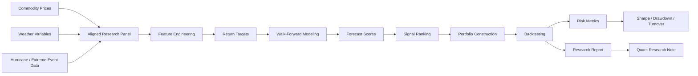

# Climate Commodity Alpha Lab

A quantitative research project for commodity return forecasting using price dynamics, weather anomalies, and extreme climate-risk signals.

## Research Question

> Can weather and climate-risk variables improve commodity return forecasts under a robust walk-forward validation framework?

## Motivation

Commodity markets are physically constrained: energy supply disrupts when hurricanes reach the Gulf of Mexico, grain yields fall under drought, and demand for natural gas spikes with temperature anomalies. This project transforms that physical domain knowledge into systematic, testable predictive signals using rigorous time-series validation.

## Architecture



## Assets

| Proxy | Commodity | Climate Relationship |
|-------|-----------|----------------------|
| UNG | Natural Gas | Temperature anomalies, hurricane disruptions |
| USO | Crude Oil | Gulf hurricane risk, supply shocks |
| DBA | Agriculture broad | Temperature, precipitation |
| CORN | Corn | Precipitation, heat stress |
| WEAT | Wheat | Drought, temperature extremes |
| SOYB | Soybeans | Precipitation, growing season climate |
| GLD | Gold | Macro/risk-off control |

## Data Sources

| Dataset | Source | Purpose |
|---------|--------|---------|
| ETF prices | Yahoo Finance (yfinance) | Commodity price proxies |
| Weather data | NOAA GHCND | Temperature, precipitation |
| Hurricane tracks | IBTrACS v4 | Tropical cyclone risk features |
| Macro variables | FRED / public sources | Optional regime context |

## Methodology

1. **Price feature engineering** — returns, momentum, volatility, drawdown, skewness
2. **Weather anomaly construction** — day-of-year climatology, rolling anomalies, drought proxies
3. **Hurricane risk scoring** — distance-weighted wind intensity for key infrastructure regions
4. **Forward return targets** — 1d, 5d, 10d, 20d horizons; directional and regression targets
5. **Walk-forward model training** — strictly temporal, no shuffling, no random splits
6. **Signal generation** — cross-sectional ranking and time-series forecasts
7. **Portfolio backtesting** — with transaction costs and turnover constraints
8. **Risk and robustness analysis** — regime breakdown, stress tests, drawdown analysis

## Models

| Model | Role |
|-------|------|
| Ridge Regression | Baseline, regularized |
| Logistic Regression | Directional baseline |
| Random Forest | Non-linear reference |
| XGBoost / LightGBM | Primary forecasting model |
| Bayesian Regression (PyMC) | Uncertainty quantification |
| Volatility / Climate Regime Detection | Conditional performance analysis |

## Evaluation Framework

| Metric | Purpose |
|--------|---------|
| Information Coefficient (IC) | Predictive quality of scores |
| Hit Rate | Directional accuracy |
| Sharpe Ratio (net) | Risk-adjusted performance |
| Max Drawdown | Downside risk |
| Turnover | Cost efficiency |
| Performance by regime | Robustness under different conditions |

## Repository Structure

```
climate-commodity-alpha-lab/
├── src/
│   ├── data/           # Data loading and panel construction
│   ├── features/       # Price, weather, hurricane and regime features
│   ├── models/         # Baseline, tree, Bayesian models + walk-forward
│   ├── backtesting/    # Signal-to-position, portfolio, performance
│   ├── risk/           # Drawdown, VaR/CVaR, stress tests
│   └── utils/          # Metrics, date utilities, leakage validation
├── notebooks/          # Ordered research notebooks (01–08)
├── reports/            # Quant research note, backtest report, figures
├── tests/              # Unit tests for all modules
└── data/               # Raw, interim and processed data (not tracked)
```

## Notebooks

| Notebook | Content |
|----------|---------|
| `01_price_data_eda.ipynb` | Price data, returns, feature distributions |
| `02_weather_climate_features.ipynb` | Weather anomalies, drought proxies |
| `03_hurricane_risk_features.ipynb` | Storm tracks, risk scoring, energy exposure |
| `04_signal_engineering.ipynb` | Feature selection, cross-asset correlations |
| `05_walk_forward_modeling.ipynb` | Model comparison under temporal validation |
| `06_backtesting_strategy.ipynb` | Signal-to-portfolio, equity curve, metrics |
| `07_regime_detection.ipynb` | Volatility and climate regime analysis |
| `08_research_report.ipynb` | Full findings as a quant research note |

## Why this project matters

Physical climate-risk modeling and systematic commodity research share the same core challenge: transforming noisy, non-stationary time-series data into robust predictive signals. This project applies hydrometeorological domain knowledge — tropical cyclone tracks, precipitation, temperature — directly to commodity return forecasting, with the same rigor expected in production quant systems: temporal validation, realistic transaction costs, and structured reporting.

## Setup

```bash
git clone https://github.com/your-username/climate-commodity-alpha-lab.git
cd climate-commodity-alpha-lab
pip install -r requirements.txt
pip install -e .
cp .env.example .env  # fill in API keys
pytest tests/
```

## CV Summary

> Built a systematic commodity forecasting pipeline using price dynamics, weather anomalies and tropical cyclone risk features. Implemented walk-forward validation, XGBoost/LightGBM models, signal generation, transaction-cost-aware backtesting and risk reporting. Designed to test whether climate-risk alternative data improves commodity return forecasts.
